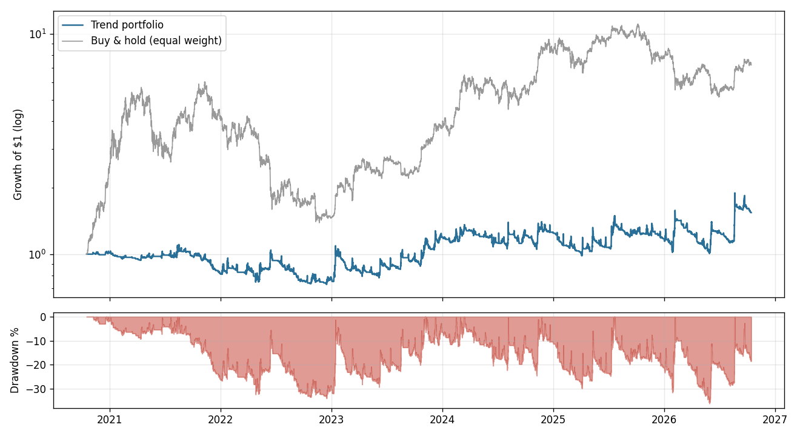

# Testing crypto trading strategies honestly

I wanted a bot that trades crypto with real money using the ICT / "smart money"
concepts popular on YouTube: **AMD (Accumulation, Manipulation, Distribution)**,
liquidity sweeps, Fair Value Gaps, support/resistance, volume profile POC.

So I built the bot, plus the tools to check whether it actually works before
risking money. Then I tested a second, completely different strategy (trend following).

**Result: neither strategy passed. Neither is traded with real money.**
This repo is the full pipeline and an honest write-up of what the data showed.

---

## TL;DR

| Strategy | Test | Result |
|---|---|---|
| AMD / smart money (15m) | 8 coins it was never tuned on, 2 years, 369 trades | **Loses**: profit factor 0.88, −27.8R |
| Trend following (4h) | 11 coins, 4 years, 914 trades, no tuning | Weak edge: profit factor 1.26 (bar was 1.3) |
| Trend following, all coins in one account | 6 years (2020–2026) | +54% total, 7.5%/yr, −36% drawdown, 810 days underwater |
| Buy & hold BTC | same 6 years | **+621%**, −77% drawdown |

Over this period, simply holding BTC beat every bot here.

---

## What's in the repo

| File | What it does |
|---|---|
| `concepts.py` | ATR, Fair Value Gaps, swing highs/lows, S/R clustering, volume profile + POC, engulfing candles, higher-timeframe bias |
| `strategy.py` | The AMD strategy as a bar-by-bar state machine. **The same code runs in backtests and live.** |
| `backtest.py` | Conservative simulator: fees, slippage, stop assumed hit first if stop and target share a candle, gaps fill at the open, realistic limit-order fills |
| `sweep.py` | Tests many settings on the first 70% of data, then checks them on the unseen last 30% |
| `coins.py` | Runs one frozen set of rules on coins that never influenced any setting |
| `trend.py` | Donchian breakout + ATR trailing stop, rules fixed before seeing any results |
| `portfolio.py` | All coins in one account, overlapping positions, compared with buy & hold |
| `live.py` | Exchange execution via ccxt (testnet by default) with safety rails |
| `data.py` | Downloads candles from the exchange's public API, with caching and retries |

### Live trading safety (`live.py`)
- Runs on **testnet** unless `live = True` in `config.py` **and** the env var `I_ACCEPT_REAL_MONEY_RISK=YES` is set
- Every position gets an exchange-side stop-loss; if the stop can't be placed, the position is closed immediately
- Checks every 15 seconds for any position without a stop
- Daily loss limit (−3%), max trades per day, leverage cap, flat by session close
- API keys only from environment variables, never in code
- Tested against a fake exchange: limit fill, rejected stop-loss, unknown position, expired order

---

## Method: how I tried not to fool myself

Backtests are easy to make look amazing. The usual ways people fool themselves, and what I did instead:

1. **Lookahead bias**: using future data by accident. Every signal is re-derived using *only* data up to that moment and must match. Swing points only become visible after they're confirmed, and a 1h candle is only used after it closes.
2. **Overfitting**: tuning until the past looks good. Settings are chosen on the first 70% of the data and judged on the last 30%.
3. **Overfitting the test set**: after looking at the out-of-sample results several times, they stop being clean. So the final test used **coins that never influenced any decision**.
4. **Moving the goalposts**: every pass/fail bar was written in the code **before** running the test, and never changed after seeing results.
5. **Ignoring costs**: taker/maker fees, slippage, and perpetual funding are all included.

---

## Results

### 1. AMD / smart money concepts (15m candles)

**Rules:** Asian session (00:00–07:00 UTC) range = accumulation. A wick beyond the range that closes back inside during London = manipulation (liquidity sweep). Enter on the displacement candle that leaves a Fair Value Gap; target the other side of the range = distribution. Plus volume, POC, S/R and engulfing-candle confluence.

- **BTC, 1 year:** 21 trades, profit factor 0.33, −9.1%.
- **TAO, 24 variants** (15m/1h, cost filters, confluence, breakouts): the best in-sample profit factor was 1.00. Nothing made money.
- **TAO, 36 variants with a 1h direction filter** (only trade with the 1h trend):
  the filter improved **every** variant compared with no filter, which is the one robust finding.
  But the top in-sample row (PF 1.72) collapsed to 0.50 out-of-sample: classic overfitting.
  The most balanced variant was PF 1.34 in-sample and 1.02 out-of-sample, which is break-even.
- **Final test, frozen rules on 8 fresh coins (2 years):**

| Coin | Trades | PF | Total R |
|---|---|---|---|
| BTC | 18 | 1.03 | +0.3 |
| ETH | 39 | 0.85 | −3.9 |
| XRP | 49 | 1.03 | +1.0 |
| BNB | 29 | 1.67 | +8.8 |
| AVAX | 60 | 0.79 | −7.8 |
| LINK | 57 | 0.50 | −21.4 |
| ADA | 61 | 1.00 | +0.1 |
| NEAR | 56 | 0.86 | −4.9 |
| **All** | **369** | **0.88** | **−27.8** |
| *TAO (tuned on)* | *57* | *1.23* | *+7.4* |

TAO, the coin it was tuned on, looks profitable. Coins it never saw lose. That gap is what overfitting looks like.

**Verdict: no edge.**

### 2. Trend following (4h candles)

**Rules, fixed in advance:** go long when a candle closes above the 20-day high, short below the 20-day low. Stop at 3 ATR, trailing behind the best close. No profit target. 1% risk per trade. Nothing tuned.

**11 coins, 4 years:** 914 trades, profit factor 1.26, +0.12R per trade, profitable on 9/11 coins, positive in both halves of the period.
Longs made +106.7R; shorts made −1.3R.
It failed the pre-set bar (PF ≥ 1.3) narrowly.

**All coins in one account:**

| | 4 years (2022–2026) | 6 years (2020–2026) |
|---|---|---|
| Total return | +98% | +54% |
| Per year | +18.7% | +7.5% |
| Worst drawdown | −36.2% | −36.2% |
| Longest below a previous high | 292 days | 810 days |
| Buy & hold BTC | +327% (−53% drawdown) | +621% (−77% drawdown) |

By year: 2020 +1%, 2021 **−19%**, 2022 **−6%**, 2023 +55%, 2024 +4%, 2025 −6%, 2026 +31%.



The 4-year result looked borderline-promising. Adding 2020–2022 killed it: the strategy lost money in the 2021 bull run **and** in the 2022 crash it was supposed to protect against.

**Verdict: not worth trading.** Drawdowns were shallower than holding, but it gave up almost all the upside to get that.

---

## Lessons

- **Concepts that look obvious on a chart are hard to make profitable as rules.** Many "setups" are only clear in hindsight.
- **One good backtest means nothing.** The AMD bot's best variant went from PF 1.72 to 0.50 on unseen data.
- **Test on data that never influenced a decision.** Untouched coins and untouched years were what actually decided things.
- **Write the pass/fail bar before you look.** Otherwise "1.26 is basically 1.3" is very tempting.
- **Fees matter most on short timeframes.** On 15m charts the stops are so tight that fees and slippage eat a big share of each trade's risk, so the bot had to skip most BTC setups.
- **Compare with doing nothing.** A bot that makes +54% sounds good until buy & hold made +621%.
- **Test your tests.** My first lookahead check was broken: it silently tested zero signals and reported "all match". I only caught it because a later run returned 0 signals where I expected some.

---

## Run it yourself

```bash
pip install -r requirements.txt

python run.py backtest --days 365      # AMD backtest (Bybit public data, no API key)
python run.py signals --days 30        # every AMD setup with the reasons it fired
python sweep.py --days 730             # AMD variants: in-sample vs out-of-sample
python coins.py --days 730             # AMD frozen rules on fresh coins
python trend.py                        # trend following, 11 coins
python portfolio.py --days 2190        # trend following, one account, vs buy & hold
```

Add `--exchange binanceusdm` to use Binance futures data, or `--synthetic` to test the code offline with fake data.

Live / testnet (not recommended with real money, see results above):
```bash
export EXCHANGE_API_KEY=...  EXCHANGE_API_SECRET=...   # testnet keys, trading permission only
python run.py live
```

---

*Not financial advice. Backtests can't predict the future, and crypto derivatives can lose more than you put in.*
